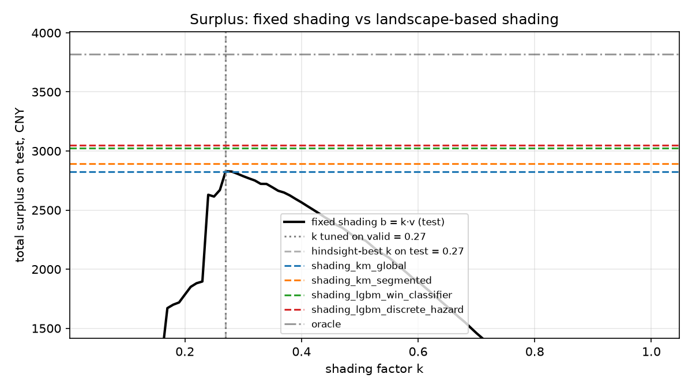

# Bid Shading Simulator

Офлайн-симулятор first-price RTB-аукциона на логах iPinYou. Проект сравнивает стратегии ставок DSP по деньгам рекламодателя: от честной ставки и фиксированного коэффициента до шейдинга на основе моделей bid landscape, обученных на цензурированных данных.

## Задача

В first-price аукционе победитель платит свою ставку, поэтому ставить полную ценность показа v означает отдавать бирже весь выигрыш. Bid shading снижает ставку b, балансируя цену и вероятность выигрыша. Для запроса с признаками x ожидаемый surplus и оптимальная ставка:

$$U(b \mid x) = (v - b)\cdot W(b \mid x), \qquad W(b \mid x) = P(z < b \mid x)$$

$$b^* = \arg\max_{b \in [0,\, v]} (v - b)\cdot W(b \mid x)$$

где z - лучшая ставка конкурентов. Главная задача - оценить win rate curve W(b | x), видя только исход своих аукционов.

## Как устроен эксперимент

1. **Данные.** Логи показов iPinYou: `bidprice` берём как ценность v, `payprice` (цена второго места в исходном second-price аукционе) - как цену конкурента z. Сплит по дням: train -> valid -> test.
2. **Цензурирование.** Для каждого запроса ставим случайную тестовую ставку b' = α*v, α ~ U(0.05, 1). Если b' > z, это выигрыш и z известна; иначе проигрыш, и известно только z >= b'. Модели видят только это.
3. **Модели ландшафта** обучаются на цензурированной выборке.
4. **Оптимизация.** Для каждого тестового запроса перебираем ставки на сетке b = q * v и берём argmax ожидаемого surplus.
5. **Симуляция.** Прогоняем ставки всех стратегий против реальных z на тесте: выигрыши, расход, surplus.

| Стратегия | Ставка | Роль |
| --- | --- | --- |
| `truthful` | b = v | Нижняя граница: выигрывает всё, surplus = 0 |
| `fixed_shading` | b = k*v, k подбирается на valid | Сильный простой бейзлайн |
| `fixed_shading_hindsight` | b = k*v, k выбран задним числом на тесте | Нечестная верхняя граница бейзлайна для проверки устойчивости |
| `shading_km_global` | argmax по Kaplan-Meier без признаков | Даёт ли что-то знание среднего рынка |
| `shading_km_segmented` | KM по сегментам exchange × размер слота × час | Персонализация без ML |
| `shading_lgbm_win_classifier` | LightGBM P(win \| x, b), монотонный по ставке | **Основная модель** |
| `shading_lgbm_discrete_hazard` | LightGBM на hazard по ценовым бинам | Полное распределение z |
| `oracle` | b = z + ε | Верхняя граница |

## Быстрый старт

Нужны Python 3.11+ и [uv](https://docs.astral.sh/uv/).

```bash
uv sync --all-extras   # зависимости, включая dev и mlflow
make test              # юнит-тесты и сквозной тест на синтетике
make smoke             # весь пайплайн на синтетических логах, ~1–2 минуты
```

`make smoke` генерирует логи в формате iPinYou с известным рыночным распределением, прогоняет `prepare` и `run` и пишет отчёт в `artifacts/synthetic/`.

Без uv: активируйте venv, `pip install -e ".[dev,tracking]"` и вызывайте цели как `make run PY=`.

## Данные

Используются кампании **1458** и **3386** (сезон 2). Цены в фэнях за 1000 показов.

**Вариант A: готовая обработка make-ipinyou-data.**  [wnzhang/make-ipinyou-data](https://github.com/wnzhang/make-ipinyou-data).

**Вариант B: сырые логи.** Распакуйте архив и логи показов второго сезона:

```bash
bzip2 -dk data/ipinyou/training2nd/imp.*.txt.bz2
```

В конфиге выставите `source: raw`. Загрузчик сам отфильтрует рекламодателей и разобьёт 7 дней на train, valid (1 день) и test (2 дня).

```bash
make prepare   # логи -> признаки -> artifacts/data/{train,valid,test}.parquet
make eda       # статистика цен, медиана z по дням и кампаниям, reports/figures/eda.png
make run       # модели, оптимизация, симуляция, отчёт
make ablation  # тот же эксперимент без weekday -> reports/no_weekday/
```

## Результаты

Кампании 1458 и 3386, второй сезон iPinYou. Train: 6–9 июня 2013 (3.4 млн показов), valid: 10 июня (0.8 млн), test: 11–12 июня (1.7 млн). Основной прогон без признака `weekday` (почему - ниже).

| Стратегия | Surplus, CNY | К фиксированному | Win rate | Доля от верхней границы |
| --- | ---: | ---: | ---: |------------------------:|
| truthful | 0 | −100% | 100.0% |                      0% |
| fixed_shading (k = 0.27) | 2 828 | 0% | 76.5% |                   74.0% |
| shading_km_global | 2 827 | −0.1% | 77.5% |                   74.0% |
| shading_km_segmented | 2 893 | +2.3% | 82.2% |                   75.7% |
| shading_lgbm_win_classifier | 3 024 | +6.9% | 86.9% |                   79.1% |
| shading_lgbm_discrete_hazard | 3 046 | +7.7% | 87.2% |                   79.7% |
| oracle | 3 821 | +35.1% | 100.0% |                    100% |

| Ландшафт | Log loss | Brier | ECE | ANLP |
| --- | ---: | ---: | ---: | ---: |
| km_global | 0.3196 | 0.0975 | 0.0155 | 3.34 |
| km_segmented | 0.2745 | 0.0844 | 0.0156 | 2.83 |
| lgbm_win_classifier | 0.1986 | 0.0593 | 0.0178 | 3.74 |
| lgbm_discrete_hazard | 0.2050 | 0.0606 | 0.0153 | 2.09 |



Ступеньки на кривой фиксированного шейдинга (например, между k = 0.23 и 0.24) - это точечные массы цены рынка около 70 фэней: как только ставка их перешагивает, выигрывается сразу большая доля аукционов.

**Выводы**

1. Шейдинг на основе ландшафта даёт +7–8% surplus к фиксированному шейдингу и одновременно поднимает win rate на 10 п.п. Это около 20% разрыва между фиксированным коэффициентом и идеальной моделью, которая заранее знает цену рынка.
2. Выигрыш устойчив. Коэффициент k = 0.27, подобранный на валидации, совпал с лучшим k, выбранным задним числом на тесте. То есть модели обгоняют лучший возможный фиксированный шейдинг.
3. Проверка логики симулятора. В логах v = 300 у всех запросов, поэтому глобальный Kaplan-Meier назначает всем одну ставку и по сути совпадает с фиксированным шейдингом.
4. Сегментный KM даёт +2.3%, бустинг +7%. Классификатор и hazard-модель приносят почти одинаковые деньги, хотя hazard обучен всего на 300 тыс. из 3.4 млн запросов. Классификатор точнее по log loss, hazard лучше по ANLP и калибровке, потому что моделирует всё распределение цены.
5. Сдвиг рынка и абляция weekday. 8 июня медианная цена рынка скачком выросла с 50–55 до 61–70 фэней у обеих кампаний одновременно и дальше держалась на этом уровне. Тестовые дни (вторник и среда) в train не встречаются, поэтому `weekday` не может обобщаться: деревья относят их к ближайшим четвергу и пятнице. Без этого признака log loss улучшился у обеих моделей, а surplus изменился в пределах +-1%.
6. Калибровка у моделей смещена в разные стороны. KM-модели в середине диапазона переоценивают вероятность выигрыша, что согласуется с ростом цен после 8 июня. Модели на LightGBM, наоборот, недооценивают её на 5–8 п.п. при предсказаниях 0.1–0.6.
7. Выигрыш сосредоточен на биржах 1 и 2 (+11% и +14% к фиксированному шейдингу у моделей на LightGBM), а на бирже 3 он около +2%. 

| Модель | Log loss с weekday | Log loss без | Surplus с weekday, CNY | Surplus без, CNY |
| --- | ---: | ---: | ---: | ---: |
| lgbm_win_classifier | 0.2031 | 0.1986 | 3 030 | 3 024 |
| lgbm_discrete_hazard | 0.2082 | 0.2050 | 3 025 | 3 046 |

Чтобы воспроизвести вариант с `weekday`, уберите `drop_features` из `configs/default.yaml`.

Что выводится:

- `reports/results.md` - таблица стратегий (surplus, uplift к фиксированному шейдингу и к k, выбранному задним числом, win rate, расход, доля от оракула) и качество ландшафтов.
- `reports/figures/surplus_vs_k.png` - surplus фиксированного шейдинга по k против модельных стратегий.
- `reports/figures/calibration.png` - калибровка W(b' | x) на тестовых ставках.
- `reports/figures/win_curves.png` - средний ландшафт моделей против эмпирического.
- `reports/figures/surplus_by_exchange.png` - где модели выигрывают больше всего.
- `reports/figures/bid_to_value.png` - распределение b/v: насколько каждая модель шейдит.
- `artifacts/run/*.csv` - те же числа для анализа, плюс важность признаков классификатора.

**Метрики ландшафта:** log loss, Brier и ECE предсказанной вероятности выигрыша на тестовых ставках; ANLP - средний минус логарифм вероятности бина, в который попала истинная z. Классификатор оптимизирует именно W при конкретной ставке и может проигрывать hazard-модели по ANLP: плотность из разности его ступенчатых предсказаний получается грубой.

## Ограничения

- Логи собраны в second-price аукционах, first-price только симулируется. `payprice` может равняться floor, а не ставке конкурента.
- В логах есть только аукционы, выигранные исходным биддером: самые дорогие запросы, где он проиграл, не видны, выборка смещена.
- Цензурирование создаётся случайными тестовыми ставками; реальный паттерн проигрышей другой.
- Рынок статичен: конкуренты не реагируют на нашу стратегию, хотя в реальности они тоже шейдят.
- v = bidprice - прокси ценности, а не реальная ценность показа для рекламодателя.
- k для фиксированного шейдинга подбирается по полным логам валидации; в проде должен быть A/B-тест, так что бейзлайн получается завышенным.
- Данные 2013 года, китайский рынок: важны относительные различия стратегий, а не абсолютные цены.

## Структура

```
configs/            default.yaml (реальные данные), synthetic.yaml (smoke test)
src/bidshade/
  data.py           чтение логов, признаки, сплит по дням, parquet (polars)
  schema.py         раскладка колонок логов iPinYou
  synthetic.py      синтетические логи с известным ландшафтом
  dataset.py        AuctionData: numpy-контейнер для моделей и симулятора
  censoring.py      тестовые ставки и цензурированная обратная связь
  landscape/        kaplan_meier.py, win_classifier.py, hazard.py
  optimizer.py      argmax (v - b) * W(b | x) по сетке ставок
  strategies.py     truthful, fixed k, oracle
  simulator.py      first-price аукцион и бизнес-метрики
  metrics.py        log loss, Brier, ANLP, калибровка
  pipeline.py       сквозной эксперимент, отчёт, MLflow
  cli.py            bidshade synthetic | prepare | eda | run
tests/              pytest
```

## Что дальше

- Калибровка W(b | x) на валидации (isotonic regression) и проверка, сколько surplus она добавляет.
- Ценность из CTR-модели: v = pCTR × целевой CPC вместо bidprice.
- Бюджетное ограничение через множитель Лагранжа: максимум surplus при расходе <= B.
- Эндпоинт `/bid` на FastAPI с замером latency инференса.
